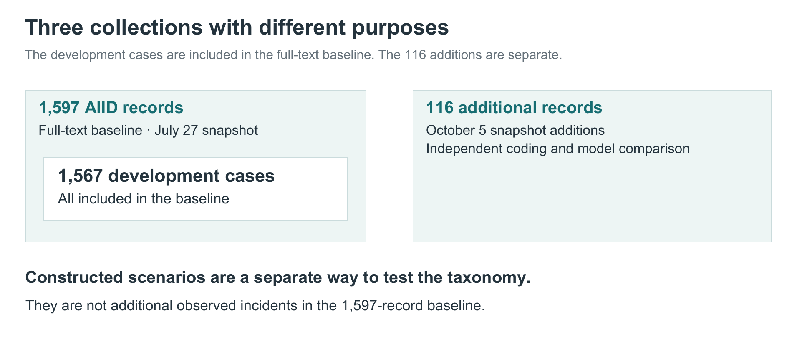

# Where our incident evidence comes from

The AI Incident Database, or AIID, is our main source of incident evidence. Its incident entries bring together reports about an event and give us identifiers that we can use to track the source of our coding.

Our work has also considered other sources and used deliberately constructed examples to test the taxonomy. These serve different purposes, so we keep them separate when describing what we have learned.

*The nested boxes show inclusion, not extra cases to add together.*

## The main AIID collection

We used **1,567 AIID cases during development** of the taxonomy and coding approach. A later coding exercise examined the full incident entries and stored linked reports for **1,597 AIID records**, using the July 27, 2026 database snapshot. All 1,567 development cases were included in that exercise.

The 1,597-record exercise is the basis for the early findings presented in this series. It includes records judged outside the scope of our study; processing a record does not necessarily mean retaining it for every analysis.

The collection contains more than 6,000 distinct linked reports. About 96% have English-language metadata. This makes the sources useful for studying reported incidents, but they do not provide a representative sample of all AI use or all AI harms. Reporting practices, language and public attention influence what enters the database.

## Other sources considered

We also considered other incident sources and framework materials alongside AIID. The table distinguishes their roles in this work.

| Source or evidence family | Role |
| --- | --- |
| AIID | Main incident collection for development, the full-text baseline, and the separate 116-entry comparison cohort. |
| OECD incident definitions | Definitions mapped to the prototype. |
| OECD AI Incidents Monitor | Other incident source considered, including a sector crosscheck. |
| AIAAIC | Other incident source considered; its harms taxonomy informed prototype development. |
| Studies, demonstrations and constructed cases | Separate tests of the taxonomy's ability to represent different mechanisms and outcomes. |

## Why we also use imagined cases

Some important risks are poorly represented in available reports. We use constructed scenarios to ask whether the taxonomy can describe a particular mechanism or outcome, assuming the scenario’s facts.

These exercises can expose missing distinctions. They cannot tell us that the imagined event occurred or how common it is. Our broader development collection therefore separates reported incidents and studies from hypothetical cases; its total should not be presented as a count of real-world incidents.
