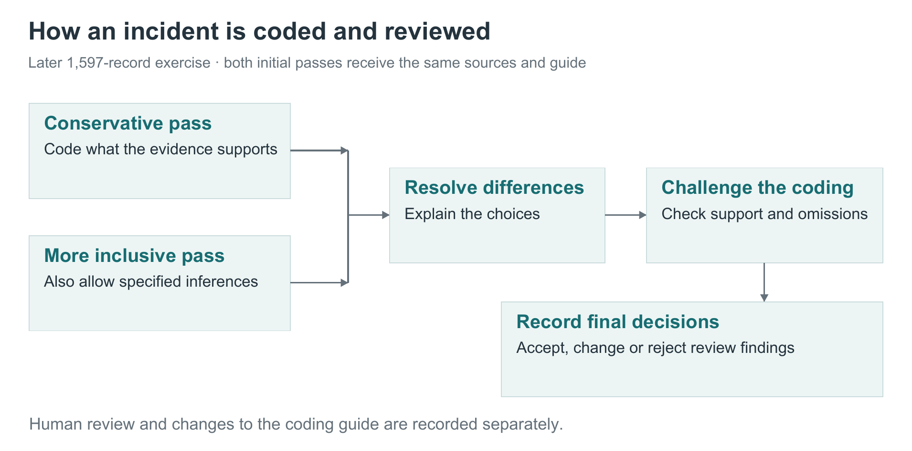

# How we code an incident

We begin with the incident evidence and ask which categories it supports. Each coding decision should have a reason that another reader can check against the source and the category’s definition.

The process uses AI to propose and review coding, with human decisions recorded separately. It developed over time. The steps below describe the later exercise covering 1,597 AIID records.

*Follow the two independent starting points into a shared review process. The more inclusive pass still needs evidence for realized harms.*

## Read the same evidence in two separate passes

Two AI coding passes receive the same incident material and coding guide, without seeing each other’s answers.

One pass is more conservative. The other can include certain carefully explained inferences about conditions that made the incident difficult to prevent, or its contribution to wider harm. Both must support any claim that a harm actually occurred. The more inclusive pass is not permission to add every plausible consequence.

This comparison helps reveal decisions that depend on how the evidence rules are applied. Because the passes generally use the same model, their agreement does not amount to agreement between independent human researchers.

## Resolve differences and challenge the answer

A third pass examines the proposed coding and resolves differences by returning to the evidence and definitions. It should explain its choices rather than simply combine all suggested categories.

A separate review then looks for mistakes: an unsupported category, a missed harm, a category that is too specific, or a connection between harms that the report does not establish. A final pass records how each review issue was handled and applies the accepted changes.

The earlier development work commonly used four AI stages followed by human review at the level of a group of cases. We distinguish that history from the later five-stage exercise.

## What a reviewable coding record contains

The reviewer needs the incident identifier and source snapshot; the taxonomy and instruction version; scope and source-quality judgments; selected categories on each axis; evidence passages and reasons; and any harm-chain or contribution links. Initial proposals, reconciliation, verifier issues, final dispositions and human corrections remain distinguishable. The effective analysis view applies recorded corrections without deleting the model output.

In the later baseline protocol, the inclusive pass could retain incident-specific **likely Challenges** and **Distal contributions** using an instructed greater-than-50% qualitative threshold. This was not a calibrated probability estimate and did not relax the evidence needed for realized harms. Reconciliation had to dispose of the inferred candidates explicitly.

## Preserve uncertainty

If a report supports a broad category but not a more specific one, we retain the broader category. If it does not support a decision, we can leave that part of the coding empty and explain why.

Three distinctions matter particularly:

- An allegation remains an allegation unless the evidence establishes more.
- A possible consequence is different from a harm that occurred.
- Missing information in a report is different from a missing category in the taxonomy.

We also distinguish harms that happened alongside one another from harms where the evidence supports a sequence. Giving two harms labels does not, by itself, establish that one caused the other.
