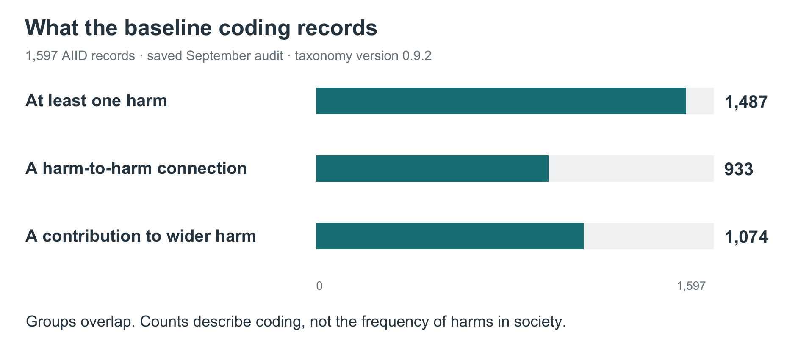

# What we have learned from the first incident collection

The work so far shows that we can apply a common vocabulary to a large collection of incident reports and describe more than a single label for each case. It has also revealed where coding judgments are difficult and where human correction matters.

These early findings concern the **1,597 AIID records** in the July 27, 2026 snapshot. They come from the saved September review of that coding exercise, using taxonomy version 0.9.2.

*Each bar uses the same 1,597-record baseline. The groups overlap and must not be summed.*

## The coding captures harms and their connections

The coding identifies at least one harm in **1,487 records**. It records an explicit connection from one harm to another in **933 records**, and a contribution to wider harm in **1,074 records**.

These groups overlap. The figures describe what was coded in the reports; they do not estimate how often these harms occur across society. A contribution to wider harm also does not mean that the incident, by itself, produced a society-wide outcome.

After the saved human decisions, 1,565 records were considered in scope and 32 outside scope. The figures above describe the full set of 1,597 processed records, rather than a separate sample of retained cases.

| Measure | Count | Share of 1,597 processed records |
| --- | ---: | ---: |
| At least one coded harm | 1,487 | 93.1% |
| Explicit harm-to-harm chain | 933 | 58.4% |
| Distal contribution link | 1,074 | 67.3% |
| No coded harm | 110 | 6.9% |

These are overlapping descriptive measures, apart from harm versus no harm. The 110 records without a coded harm are a different measure from the 110 records with saved human verification. A record without a coded harm is not automatically outside scope. Structural checks found no unresolved chain references or cycles; they do not validate the causal interpretation.

## Some distinctions repeatedly require judgment

A recurring difficulty is deciding whether a report establishes an outcome or only a danger. Another is deciding whether it describes harm to particular people or a wider condition affecting institutions or society.

The work also tests how much detail a category can reasonably claim. A report may support a general failure without explaining exactly why it happened. Adding a specific mechanism in that situation would make the coding look more informative than the evidence allows.

These difficulties have informed changes to definitions, coding instructions and the taxonomy itself. Constructed scenarios have helped test difficult boundaries too, so changes made during incident development should not all be described as discoveries from real incidents.

## Human review remains essential

The saved review includes human verification of **110 records**, with complete replacement of the model’s final coding in **37** of them. The other records retain their model-produced final coding.

That demonstrates the value of human review, but the reviewed cases do not provide a random sample from which to estimate the overall error rate. Completing the AI workflow is therefore a different milestone from validating the full collection with people.

The next study addresses this directly: people will code a separate set of 116 incidents before seeing model answers. That will help us distinguish consistent model behavior from coding that independent readers find well supported.
