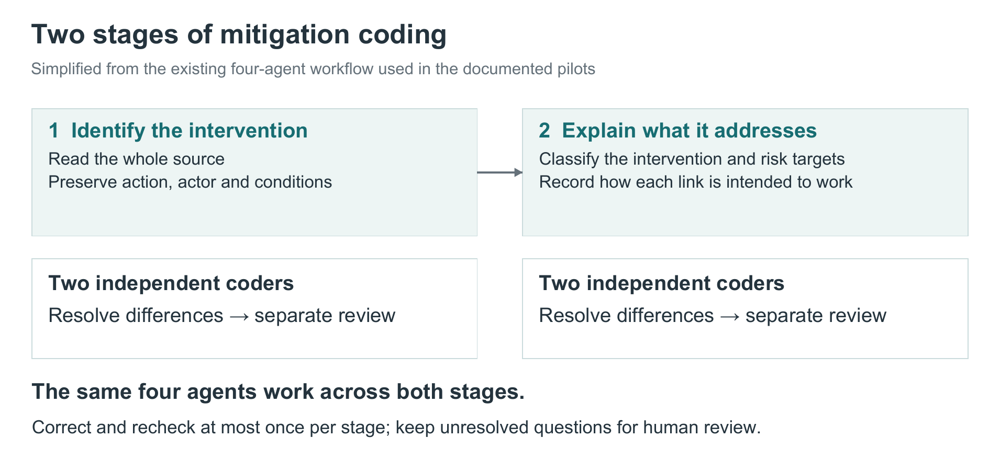

# How we code proposed mitigations

Incident coding describes what went wrong. Mitigation coding asks what a source proposes doing about a risk, who would act, and how that action is intended to help.

We begin with source documents and preserve their wording and conditions. A recommendation to monitor a problem, for example, is different from a requirement to stop an activity when the problem is detected.

*A shorter version of our existing mitigation process diagram. [Open the detailed workflow](figures/mitigation-detailed.svg).*

## Identify the intervention

Two AI coders independently read the source and identify its interventions. They retain the action, the responsible actor, the circumstances in which it applies, and any qualifications or exceptions.

Repeated mentions do not automatically become separate mitigations. Nor should every step in a procedure be counted separately. Checking something, detecting a failure and responding to it may together form one meaningful intervention.

A reconciler resolves differences between the coders. A separate reviewer checks the source for omissions, inappropriate splitting or merging, and lost conditions. The documented pilots allow a bounded correction and recheck rather than an indefinite series of revisions.

## Explain what the intervention does

The reviewed interventions then receive two kinds of classification: what kind of intervention they are, and which risks they address. Each risk link includes an explanation of the relationship.

An intervention might directly reduce a risk, help another intervention work, detect a problem, support recovery, or introduce a tradeoff. These relationships should remain distinct.

One data-security example makes the distinction concrete. A provider can supply assurances about training data. A customer can require certification before accepting it. A customer can also check a download and discard it if verification fails. These are related actions, but they depend on different decisions and provide different kinds of protection. An assurance needs to be assessed; a check needs an appropriate response.

We also retain interventions when the source does not justify a specific risk link. An unexplained blank should be avoided, but a reasoned decision not to assign a link is useful information.

## Connect mitigations to incident coding

Both workflows refer to versioned risk concepts. Incident coding links evidence to a mechanism, capability, outcome or standing condition. Mitigation coding links a source-grounded intervention to a supported risk target and a relationship: **direct reduction, conditional reduction, observation, enablement, remedy or recovery, or adverse tradeoff**. The common vocabulary makes these records searchable together while preserving what each source actually supports.

A link is a candidate explanation of protective function, not a causal estimate of prevention.

The October 1 pilots used the same four agent roles across extraction and mapping, with at most one correction and one recheck per stage. Human review addresses ambiguous intervention boundaries, source meaning and mappings; unresolved questions remain held. These pilot procedures should not be attributed uniformly to every historical source run.

## Combine sources without losing their differences

Our consolidation work brings together **4,532 source records**. This is not a count of distinct mitigations: several records can describe the same intervention, and similar interventions can differ in important ways.

When records are grouped, we preserve their original sources and qualifications. A risk link supported by one source should not automatically be attributed to every other source in the group. Human decisions about grouping and mapping remain open, so there is not yet a final accepted count of distinct interventions.

The resulting catalogue describes how interventions are intended to work. Establishing whether they work in practice requires additional evidence about implementation and effectiveness.
