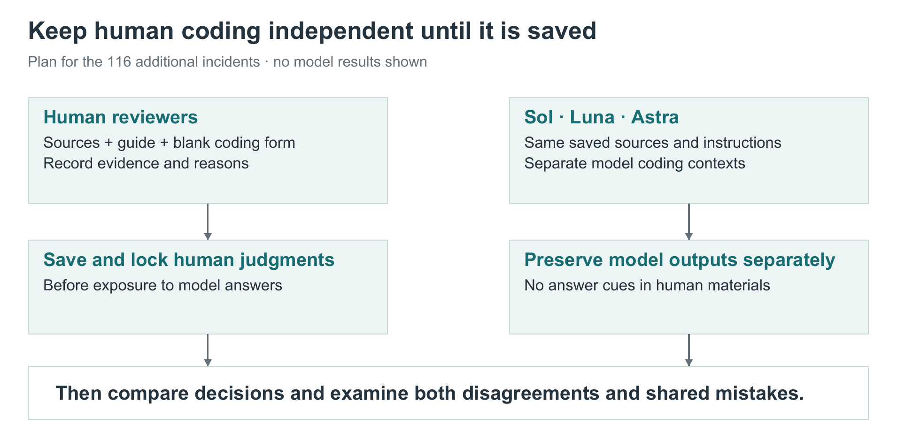

# How we will validate the coding and expand the work

Our next priority is to understand how well the coding holds up when different models and independent people examine the same incidents. That evidence should guide expansion of the incident collection and refinement of the coding instructions.

## Why the earlier agreement was not good enough

The historical comparison used the same 1,597 AIID records and frozen v0.9.2 codebook in two five-stage coding pipelines: Claude Opus 5 and GPT-5.6-sol. Broad capability coding was relatively consistent, but the models frequently disagreed about which harms and standing conditions belonged in the same incident. This was inter-model agreement between configured pipelines, not independent human intercoder reliability. The model settings and execution adapters also differed.

| Axis at type level | Incidents with a label from either pipeline | Mean Jaccard overlap | Exact set agreement |
| --- | ---: | ---: | ---: |
| Cause | 1,581 | 0.794 | 63.4% |
| Vector | 1,577 | 0.912 | 84.0% |
| Proximal harm | 1,518 | 0.669 | 30.7% |
| Realized Distal harm | 149 | 0.388 | 30.2% |
| Challenges | 1,567 | 0.394 | 6.4% |

Jaccard measures the shared labels as a fraction of all labels selected by either pipeline; 1 means identical sets and 0 means no overlap. Exact set agreement requires every selected type on that axis to match. The table excludes cases where both pipelines left the axis empty.

The weakest results were substantive. Challenges matched exactly in only **6.4%** of active cases. In **78 of the 149** active Distal cases, only one pipeline judged that any Distal harm had been realized. Across all five axes, complete type sets matched in only **17 of 1,581 incidents with any selected type (1.1%)**. This strict whole-record measure does not mean every other record was wholly wrong, but it shows that the full decomposition was rarely reproduced exactly.

Counting shared empty axes can obscure these problems. For Distal harm, including 1,448 cases where neither pipeline selected a label raises mean Jaccard to 0.943, compared with 0.388 on active cases. Agreement also fell at finer levels of detail: Proximal fine-path overlap was 0.568 and Challenge fine-path overlap was 0.360. Broad agreement therefore could not establish reliable detailed coding.

In an earlier review, a human examined the GPT pipeline's completed coding for **110 incidents** and made changes to **37 records (33.6%)**. For **26 of those records**, the changes affected which risk types were assigned; other changes could concern explanations, evidence qualifications, or other details. The review showed concrete decisions that needed correction or clarification.

These incidents were reviewed in incident-ID order rather than sampled randomly, so we cannot assume the same proportion would need changes across the full collection. The reviewer also saw the model's answers before making decisions. The new experiment will instead have human reviewers code the incidents independently before seeing model answers, allowing us to measure how often they reach the same decisions.

*Historical figures: the retained September 11, 2026 analysis of the original v0.9.2 model finals, before human overrides. These are development findings, separate from the held-out 116-entry experiment.*

## How we used the disagreements to improve the codebook

We examined disagreement patterns and concrete cases to identify where coding depended on unclear inclusion thresholds, overlapping definitions, or conflicting instructions. Neither model was consistently more permissive: one assigned more Challenges, while the other assigned more Proximal harms. The response was to make the decisions more explicit rather than simply ask every coder to be stricter.

| Recurring difficulty | Changes to the coding guidance |
| --- | --- |
| Adding labels because they commonly accompany another label | Require separate support for additional codes and distinguish a discrete failure from a standing Challenge. |
| Treating a bounded incident as proof of systemic harm | Separate Proximal outcomes, realized Distal outcomes, and supported contributions. Headcount, duration, and severity alone do not determine the axis. |
| Forcing a narrow category despite missing details | Permit the supported parent concept when subtype criteria are absent; record uncertainty rather than inventing specificity. |
| Confusing generated false content with its consequences | Distinguish the generating mechanism, the capability, corruption of a record, effects on belief, and other separately evidenced harms. |
| Using vague governance explanations | Require an identified missing or inadequate function and its connection to prevention or response; prefer a specific category when it fully describes the deficiency. |
| Losing source qualifications | Preserve allegations, unknown provenance, source limitations, and the distinction between direct evidence and permitted inference. |

Development included human decisions, revised definitions and boundary notes, and targeted review of the later v0.9.5 instructions against the old disagreements. For example, privacy guidance was broadened to cover unauthorized processing without requiring proof of retention, and infrastructure cases could leave Vector empty when no AI capability operated the harmful infrastructure. These changes addressed specific coding problems; they were not measured improvements in reliability.

The pre-experiment codebook review also identified remaining conflicts between general rules, category notes, and what the coding software could represent. This made it necessary to bind the actual experiment to frozen definitions, instructions, source packets, and output rules. The historical scores cannot establish whether the revised instrument works better. The new experiment is intended to test its reproducibility and agreement with independent human judgments; differences in cohort, models, and protocol mean it is not a controlled estimate of the codebook changes' effect alone.

*The two sides remain separate until independent human coding has been saved. This is the comparison plan, not a results graphic.*

## Compare the same 116 incidents

The comparison uses 116 AIID entries added between the July 27 and October 5, 2026 snapshots. An entry added during that period may describe an older event.

The planned model comparison includes **Sol, Luna and Astra**. Each should work from the same saved incident material, taxonomy and instructions. We will compare like stages of the process, so an initial coding pass is not treated as equivalent to an answer that has already undergone review.

The experiment addresses three separate questions:

1. **Inter-model reliability:** do Sol, Luna and Astra select the same concepts from identical evidence under the revised coding guide? We want to see whether inter-model agreement is better this time, after our work to clarify the codebook and address the disagreements in the earlier comparison.
2. **Agreement with human reviewers:** do those model decisions match independent human coding, and what explains differences when the sources are examined?
3. **Effect of the review process:** do reconciliation and verification improve the supported coding, or merely make model outputs more similar?

We will preserve and compare equivalent stages, including initial coding and the reviewed final where available. Agreement is useful evidence of consistency, but models can agree on a mistake. Claude belongs only to the historical comparison above and is excluded from this new comparison plan.

## Examine the reasons for agreement and disagreement

We will look separately at causes, capabilities, harms and continuing challenges. We will ask whether the selected categories are supported, whether important information was missed, and whether claimed connections between harms are justified.

Reviewing a sample of model agreements is important too: otherwise, a shared mistake could escape attention. We should decide the sampling and assessment rules before inspecting the results.

## Expand in manageable steps

Once validation identifies the main weaknesses, we can test the next batch of incidents while tracking how much source material is available, how often correction is needed, and the time and cost of producing usable coding.

Broader coverage should include different languages, sectors and incident sources. When adding another database, retain source identifiers and document overlap with AIID so the same event is not silently counted twice.

Mitigation expansion has a related priority: resolve the outstanding grouping and mapping decisions while preserving each source’s conditions. Across both workstreams, the aim is a larger body of evidence that reviewers can understand and check, with a clear record of what people have validated.
