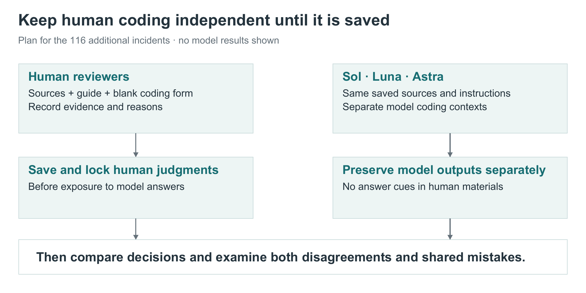

# How we will validate the coding and expand the work

Our next priority is to understand how well the coding holds up when different models and independent people examine the same incidents. That evidence should guide expansion of the incident collection and refinement of the coding instructions.

## Why the earlier agreement was not good enough

The historical comparison used the same 1,597 AIID records and frozen v0.9.2 codebook in two five-stage coding pipelines: Claude Opus 5 and GPT-5.6-sol. Broad capability coding was relatively consistent, but the models frequently disagreed about which harms and standing conditions belonged in the same incident. This was inter-model agreement between configured pipelines, not independent human intercoder reliability. The model settings and execution adapters also differed.

| Axis at type level | Incidents with a label from either pipeline | Mean Jaccard overlap | Exact set agreement |
| --- | ---: | ---: | ---: |
| Cause | 1,581 | 0.794 | 63.4% |
| Vector | 1,577 | 0.912 | 84.0% |
| Proximal harm | 1,518 | 0.669 | 30.7% |
| Realized Distal harm | 149 | 0.388 | 30.2% |
| Challenges | 1,567 | 0.394 | 6.4% |

Jaccard measures the shared labels as a fraction of all labels selected by either pipeline; 1 means identical sets and 0 means no overlap. Exact set agreement requires every selected type on that axis to match. The table excludes cases where both pipelines left the axis empty.

The weakest results were substantive. Challenges matched exactly in only **6.4%** of active cases. In **78 of the 149** active Distal cases, only one pipeline judged that any Distal harm had been realized. Across all five axes, complete type sets matched in only **17 of 1,581 incidents with any selected type (1.1%)**. This strict whole-record measure does not mean every other record was wholly wrong, but it shows that the full decomposition was rarely reproduced exactly.

Counting shared empty axes can obscure these problems. For Distal harm, including 1,448 cases where neither pipeline selected a label raises mean Jaccard to 0.943, compared with 0.388 on active cases. Agreement also fell at finer levels of detail: Proximal fine-path overlap was 0.568 and Challenge fine-path overlap was 0.360. Broad agreement therefore could not establish reliable detailed coding.

In an earlier review, a human examined the GPT pipeline's completed coding for **110 incidents** and made changes to **37 records (33.6%)**. For **26 of those records**, the changes affected which risk types were assigned; other changes could concern explanations, evidence qualifications, or other details. The review showed concrete decisions that needed correction or clarification.

These incidents were reviewed in incident-ID order rather than sampled randomly, so we cannot assume the same proportion would need changes across the full collection. The reviewer also saw the model's answers before making decisions. The new experiment will instead have human reviewers code the incidents independently before seeing model answers, allowing us to measure how often they reach the same decisions.

*Historical figures: the retained September 11, 2026 analysis of the original v0.9.2 model finals, before human overrides. These are development findings, separate from the held-out 116-entry experiment.*

## How we used the disagreements to improve the codebook

We examined disagreement patterns and concrete cases to identify where coding depended on unclear inclusion thresholds, overlapping definitions, or conflicting instructions. Neither model was consistently more permissive: one assigned more Challenges, while the other assigned more Proximal harms. The response was to make the decisions more explicit rather than simply ask every coder to be stricter.

| Recurring difficulty | Changes to the coding guidance |
| --- | --- |
| Adding labels because they commonly accompany another label | Require separate support for additional codes and distinguish a discrete failure from a standing Challenge. |
| Treating a bounded incident as proof of systemic harm | Separate Proximal outcomes, realized Distal outcomes, and supported contributions. Headcount, duration, and severity alone do not determine the axis. |
| Forcing a narrow category despite missing details | Permit the supported parent concept when subtype criteria are absent; record uncertainty rather than inventing specificity. |
| Confusing generated false content with its consequences | Distinguish the generating mechanism, the capability, corruption of a record, effects on belief, and other separately evidenced harms. |
| Using vague governance explanations | Require an identified missing or inadequate function and its connection to prevention or response; prefer a specific category when it fully describes the deficiency. |
| Losing source qualifications | Preserve allegations, unknown provenance, source limitations, and the distinction between direct evidence and permitted inference. |

Development included human decisions, revised definitions and boundary notes, and targeted review of the later v0.9.5 instructions against the old disagreements. For example, privacy guidance was broadened to cover unauthorized processing without requiring proof of retention, and infrastructure cases could leave Vector empty when no AI capability operated the harmful infrastructure. These changes addressed specific coding problems; they were not measured improvements in reliability.

The pre-experiment codebook review also identified remaining conflicts between general rules, category notes, and what the coding software could represent. This made it necessary to bind the actual experiment to frozen definitions, instructions, source packets, and output rules. The historical scores cannot establish whether the revised instrument works better. The new experiment is intended to test its reproducibility and agreement with independent human judgments; differences in cohort, models, and protocol mean it is not a controlled estimate of the codebook changes' effect alone.

*The two sides remain separate until independent human coding has been saved. This is the comparison plan, not a results graphic.*

## New GPT results: agreement at each coding stage

*Updated November 5, 2026; frozen v0.9.5 instrument; saved outputs only, with no new model calls.*

The GPT stage audit is now available. The planned cohort contains **116 entries**: four setup pilots (1617, 1623, 1673, 1679) and 112 held-out incidents. The primary comparison below uses the **same 105 held-out incidents** with accepted, source-matching records at all five stages for all three models. Seven held-out cases are excluded from this complete-stage comparison (1609, 1611, 1629, 1655, 1663, 1667, 1677); missing or excluded stages vary by model. They are not counted as disagreements. This complete-case sample may differ from the excluded cases.

Model identifiers in the saved records are **Sol: gpt-6.1-sol; Astra: gpt-6-astra; Luna: gpt-6-luna**. These are comparisons of configured pipelines, not independent human coders or estimates of correctness.

Strict and lenient coders independently read the source. Both allow express support and strong definition-permitted inference; lenient additionally considers eligible likelihood-only Challenges and contributions with positive support. Reconciliation resolves the two readings within each model's pipeline. The verifier critiques that reconciliation; it does not produce a replacement coding, so it has no category-set agreement column. Final coding incorporates the adjudicator's decisions about verifier issues. There is no cross-model consensus step.

**How to read the tables:** each cell gives **exact set agreement (matching incidents / 105); mean Jaccard overlap**. Exact agreement requires identical selected category sets; Jaccard gives partial credit for shared categories. Both-empty sets count as agreement and Jaccard 1. These are descriptive measures, not chance-corrected reliability coefficients. Pairwise comparisons are shown separately; they are not three-model unanimity.

### Whole-incident agreement through the stages

This combines category IDs across all five axes. It does not compare rationales, evidence, confidence, primary status, harm-chain edges, or contribution-source edges. Distal means the selected **contribution target categories**, not independently established realized societal harms.

| Model pair | Strict | Lenient | Reconciled | Final |
| --- | --- | --- | --- | --- |
| Sol–Astra | 18.1% (19/105); 77.7% | 10.5% (11/105); 79.1% | 17.1% (18/105); 80.3% | 18.1% (19/105); 81.0% |
| Sol–Luna | 1.9% (2/105); 45.1% | 1.0% (1/105); 40.6% | 0.0% (0/105); 43.1% | 0.0% (0/105); 43.1% |
| Astra–Luna | 1.9% (2/105); 42.5% | 0.0% (0/105); 40.2% | 1.0% (1/105); 42.6% | 1.0% (1/105); 43.6% |

### Final coding at progressively finer tiers

L1 retains the first category below the axis; L2 retains two levels; L3 three; L4 four. Paths are truncated at the requested depth. A selected parent remains a parent: no unselected descendants are inferred. Vector ends at L2, Cause and Challenges at L3, and Proximal and Distal at L4; shorter paths stay unchanged at deeper tiers. The whole-incident table combines all five axes at each tier.

| Model pair | L1: broad | L2 | L3 | L4: full depth |
| --- | --- | --- | --- | --- |
| Sol–Astra | 46.7% (49/105); 91.0% | 26.7% (28/105); 84.3% | 18.1% (19/105); 81.0% | 18.1% (19/105); 81.0% |
| Sol–Luna | 1.0% (1/105); 60.2% | 0.0% (0/105); 47.3% | 0.0% (0/105); 43.1% | 0.0% (0/105); 43.1% |
| Astra–Luna | 1.9% (2/105); 61.0% | 1.0% (1/105); 47.3% | 1.0% (1/105); 43.6% | 1.0% (1/105); 43.6% |

### Each axis and tier, at every coding stage

These tables make broad agreement distinguishable from agreement about specific subcategories. Expand a model pair to inspect strict, lenient, reconciled and final coding on the same cases.

Sol–Astra: all axes and tiers

| Axis / tier | Strict | Lenient | Reconciled | Final |
| --- | --- | --- | --- | --- |
| Cause / L1 | 94.3% (99/105); 96.8% | 92.4% (97/105); 95.9% | 94.3% (99/105); 97.1% | 94.3% (99/105); 97.1% |
| Cause / L2 | 86.7% (91/105); 92.2% | 84.8% (89/105); 90.6% | 87.6% (92/105); 92.6% | 87.6% (92/105); 92.6% |
| Cause / L3 | 79.0% (83/105); 87.8% | 77.1% (81/105); 85.0% | 81.0% (85/105); 87.6% | 81.9% (86/105); 88.3% |
| Vector / L1 | 81.0% (85/105); 91.6% | 80.0% (84/105); 91.0% | 83.8% (88/105); 93.3% | 82.9% (87/105); 93.3% |
| Vector / L2 | 64.8% (68/105); 82.7% | 67.6% (71/105); 84.5% | 67.6% (71/105); 86.0% | 67.6% (71/105); 86.0% |
| Proximal / L1 | 68.6% (72/105); 87.2% | 66.7% (70/105); 87.1% | 70.5% (74/105); 88.1% | 73.3% (77/105); 89.2% |
| Proximal / L2 | 60.0% (63/105); 84.6% | 56.2% (59/105); 84.4% | 61.9% (65/105); 85.7% | 61.9% (65/105); 86.2% |
| Proximal / L3 | 55.2% (58/105); 82.6% | 49.5% (52/105); 80.8% | 56.2% (59/105); 82.9% | 57.1% (60/105); 83.9% |
| Proximal / L4 | 55.2% (58/105); 82.6% | 49.5% (52/105); 80.8% | 56.2% (59/105); 82.9% | 57.1% (60/105); 83.9% |
| Distal / L1 | 85.7% (90/105); 86.2% | 85.7% (90/105); 88.4% | 88.6% (93/105); 90.5% | 88.6% (93/105); 90.5% |
| Distal / L2 | 82.9% (87/105); 83.8% | 81.0% (85/105); 85.2% | 81.0% (85/105); 85.5% | 81.0% (85/105); 85.5% |
| Distal / L3 | 81.9% (86/105); 82.9% | 79.0% (83/105); 83.6% | 79.0% (83/105); 83.3% | 79.0% (83/105); 83.3% |
| Distal / L4 | 81.9% (86/105); 82.9% | 79.0% (83/105); 83.6% | 79.0% (83/105); 83.3% | 79.0% (83/105); 83.3% |
| Challenges / L1 | 82.9% (87/105); 88.4% | 81.9% (86/105); 90.0% | 86.7% (91/105); 92.7% | 86.7% (91/105); 92.7% |
| Challenges / L2 | 63.8% (67/105); 80.1% | 58.1% (61/105); 80.6% | 61.9% (65/105); 82.9% | 63.8% (67/105); 84.1% |
| Challenges / L3 | 61.0% (64/105); 77.6% | 56.2% (59/105); 79.2% | 56.2% (59/105); 79.6% | 58.1% (61/105); 81.1% |

Sol–Luna: all axes and tiers

| Axis / tier | Strict | Lenient | Reconciled | Final |
| --- | --- | --- | --- | --- |
| Cause / L1 | 72.4% (76/105); 80.6% | 72.4% (76/105); 82.7% | 72.4% (76/105); 82.4% | 72.4% (76/105); 82.4% |
| Cause / L2 | 53.3% (56/105); 64.0% | 50.5% (53/105); 64.6% | 50.5% (53/105); 64.1% | 51.4% (54/105); 65.1% |
| Cause / L3 | 45.7% (48/105); 56.2% | 45.7% (48/105); 55.6% | 44.8% (47/105); 55.5% | 42.9% (45/105); 55.1% |
| Vector / L1 | 55.2% (58/105); 77.7% | 55.2% (58/105); 76.0% | 51.4% (54/105); 75.5% | 51.4% (54/105); 74.9% |
| Vector / L2 | 28.6% (30/105); 57.3% | 31.4% (33/105); 56.9% | 25.7% (27/105); 57.6% | 26.7% (28/105); 57.0% |
| Proximal / L1 | 36.2% (38/105); 63.5% | 31.4% (33/105); 59.6% | 32.4% (34/105); 63.3% | 25.7% (27/105); 59.0% |
| Proximal / L2 | 24.8% (26/105); 55.5% | 21.0% (22/105); 53.0% | 21.9% (23/105); 57.1% | 14.3% (15/105); 53.2% |
| Proximal / L3 | 23.8% (25/105); 53.1% | 20.0% (21/105); 49.7% | 19.0% (20/105); 53.1% | 13.3% (14/105); 49.5% |
| Proximal / L4 | 23.8% (25/105); 53.1% | 20.0% (21/105); 49.7% | 19.0% (20/105); 53.1% | 13.3% (14/105); 49.5% |
| Distal / L1 | 78.1% (82/105); 80.5% | 50.5% (53/105); 55.9% | 59.0% (62/105); 63.5% | 59.0% (62/105); 63.5% |
| Distal / L2 | 77.1% (81/105); 79.5% | 41.9% (44/105); 50.5% | 53.3% (56/105); 59.2% | 52.4% (55/105); 58.7% |
| Distal / L3 | 77.1% (81/105); 79.5% | 40.0% (42/105); 48.3% | 50.5% (53/105); 56.5% | 50.5% (53/105); 56.9% |
| Distal / L4 | 77.1% (81/105); 79.5% | 40.0% (42/105); 48.3% | 50.5% (53/105); 56.5% | 50.5% (53/105); 56.9% |
| Challenges / L1 | 43.8% (46/105); 53.0% | 26.7% (28/105); 44.4% | 35.2% (37/105); 48.4% | 40.0% (42/105); 52.1% |
| Challenges / L2 | 33.3% (35/105); 45.2% | 10.5% (11/105); 26.8% | 19.0% (20/105); 34.3% | 19.0% (20/105); 35.7% |
| Challenges / L3 | 33.3% (35/105); 42.5% | 10.5% (11/105); 25.3% | 18.1% (19/105); 31.5% | 18.1% (19/105); 32.6% |

Astra–Luna: all axes and tiers

| Axis / tier | Strict | Lenient | Reconciled | Final |
| --- | --- | --- | --- | --- |
| Cause / L1 | 69.5% (73/105); 78.4% | 71.4% (75/105); 82.1% | 71.4% (75/105); 81.3% | 71.4% (75/105); 81.3% |
| Cause / L2 | 50.5% (53/105); 61.7% | 51.4% (54/105); 64.4% | 48.6% (51/105); 62.2% | 49.5% (52/105); 63.2% |
| Cause / L3 | 43.8% (46/105); 53.6% | 45.7% (48/105); 55.8% | 41.0% (43/105); 52.3% | 41.0% (43/105); 52.7% |
| Vector / L1 | 61.0% (64/105); 79.4% | 59.0% (62/105); 78.4% | 57.1% (60/105); 78.0% | 56.2% (59/105); 77.0% |
| Vector / L2 | 35.2% (37/105); 57.8% | 32.4% (34/105); 56.8% | 30.5% (32/105); 58.9% | 31.4% (33/105); 58.2% |
| Proximal / L1 | 38.1% (40/105); 62.8% | 31.4% (33/105); 59.7% | 32.4% (34/105); 62.4% | 29.5% (31/105); 60.8% |
| Proximal / L2 | 26.7% (28/105); 54.1% | 21.9% (23/105); 53.5% | 22.9% (24/105); 57.2% | 20.0% (21/105); 56.1% |
| Proximal / L3 | 24.8% (26/105); 52.1% | 20.0% (21/105); 51.0% | 20.0% (21/105); 54.0% | 19.0% (20/105); 53.7% |
| Proximal / L4 | 24.8% (26/105); 52.1% | 20.0% (21/105); 51.0% | 20.0% (21/105); 54.0% | 19.0% (20/105); 53.7% |
| Distal / L1 | 74.3% (78/105); 76.2% | 51.4% (54/105); 57.8% | 60.0% (63/105); 65.2% | 60.0% (63/105); 65.2% |
| Distal / L2 | 73.3% (77/105); 75.7% | 44.8% (47/105); 52.7% | 54.3% (57/105); 61.0% | 54.3% (57/105); 60.8% |
| Distal / L3 | 72.4% (76/105); 74.8% | 42.9% (45/105); 49.3% | 52.4% (55/105); 58.3% | 53.3% (56/105); 59.3% |
| Distal / L4 | 72.4% (76/105); 74.8% | 42.9% (45/105); 49.3% | 52.4% (55/105); 58.3% | 53.3% (56/105); 59.3% |
| Challenges / L1 | 42.9% (45/105); 51.3% | 31.4% (33/105); 47.9% | 38.1% (40/105); 50.3% | 42.9% (45/105); 54.0% |
| Challenges / L2 | 30.5% (32/105); 41.3% | 12.4% (13/105); 29.6% | 19.0% (20/105); 34.3% | 19.0% (20/105); 35.7% |
| Challenges / L3 | 29.5% (31/105); 38.9% | 11.4% (12/105); 28.2% | 19.0% (20/105); 32.5% | 19.0% (20/105); 33.6% |

### Sensitivity to shared empty axes

For the final coding at exact category-ID resolution, the following excludes cases where both pipelines selected no category on that axis. Active sample sizes vary by pair and axis. This is especially relevant to Distal contributions and Challenges.

| Pair / axis | Active incidents | Exact agreement, active only | Mean Jaccard, active only | Both empty |
| --- | ---: | ---: | ---: | ---: |
| Sol–Astra / Cause | 105 | 81.9% | 88.3% | 0 |
| Sol–Astra / Vector | 104 | 67.3% | 85.9% | 1 |
| Sol–Astra / Proximal | 102 | 55.9% | 83.4% | 3 |
| Sol–Astra / Distal | 76 | 71.1% | 77.0% | 29 |
| Sol–Astra / Challenges | 92 | 52.2% | 78.5% | 13 |
| Sol–Luna / Cause | 105 | 42.9% | 55.1% | 0 |
| Sol–Luna / Vector | 104 | 26.0% | 56.5% | 1 |
| Sol–Luna / Proximal | 102 | 10.8% | 48.0% | 3 |
| Sol–Luna / Distal | 75 | 30.7% | 39.7% | 30 |
| Sol–Luna / Challenges | 92 | 6.5% | 23.0% | 13 |
| Astra–Luna / Cause | 105 | 41.0% | 52.7% | 0 |
| Astra–Luna / Vector | 104 | 30.8% | 57.8% | 1 |
| Astra–Luna / Proximal | 102 | 16.7% | 52.3% | 3 |
| Astra–Luna / Distal | 73 | 32.9% | 41.4% | 32 |
| Astra–Luna / Challenges | 92 | 7.6% | 24.2% | 13 |

### What these results support

Sol and Astra are substantially more similar to each other than either is to Luna. Coarse agreement exceeds detailed agreement. Even Sol–Astra's final 81.0% mean whole-incident overlap corresponds to only 19/105 identical category sets (18.1%). Reconciliation and final adjudication do not consistently increase cross-model agreement. Neither increasing similarity nor completing the review workflow establishes that coding is better supported by the evidence.

The source audit retained usable records with validation flags. Its separate explanation-ledger audit found mismatches in 31 of 315 model–incident cases; these are not 31 proven classification errors, but they limit claims that authored change logs fully explain the saved output changes. Agreement here is calculated from saved coding objects. No independent human accuracy result is reported. These results also cannot isolate improvement over v0.9.2: cohorts, models, instruments and protocols differ, and the earlier Distal measure concerned realized harms rather than the contribution targets measured here.

[Download aggregate metrics, cohort membership, coverage and source hashes](figures/gpt-reliability-20261105.json). The download includes all reported stages and levels, active-only metrics and manifest and codebook hashes; it excludes incident answers and source report text. Metrics were independently recalculated from the November 4 GPT stage-trace manifest and exactly reproduce its uncollapsed agreement results. Frozen concept paths supply the tier projections.

## Independent human validation remains next

Human reviewers should complete and lock their coding before inspecting model answers. The human reference can then test source support, missed codes, and harm relationships, including a sample of model agreements to detect shared mistakes. The planned 116-entry collection and the 105-case complete-stage model analysis should retain their distinct denominators. Review sampling and assessment rules should be specified before examining case-level model results.

## Expand in manageable steps

Once validation identifies the main weaknesses, we can test the next batch of incidents while tracking how much source material is available, how often correction is needed, and the time and cost of producing usable coding.

Broader coverage should include different languages, sectors and incident sources. When adding another database, retain source identifiers and document overlap with AIID so the same event is not silently counted twice.

Mitigation expansion has a related priority: resolve the outstanding grouping and mapping decisions while preserving each source’s conditions. Across both workstreams, the aim is a larger body of evidence that reviewers can understand and check, with a clear record of what people have validated.
